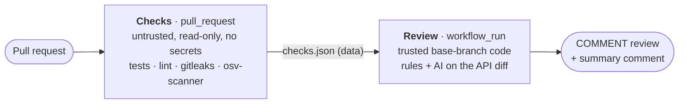

# PR Sentinel

Advisory pull request review for GitHub. PR Sentinel runs your tests and scanners, applies
deterministic security rules to the diff, asks a model (Gemini or Claude) for the bugs rules can't see, and posts
only findings it can tie to a real changed line. It never approves, requests changes, or merges.

```
🟠 HIGH · security — Authorization check lets every non-admin export any organisation

    return user.org_id == org.id or user.role != "admin"

The `or` makes the check pass for any user whose role is not "admin", regardless of
organisation. A regular user in org A can export org B's users.
Recommendation: Require both conditions …
Source: AI `ai-security` · confidence 0.93 · AI-generated, verify before acting
```

## How it works



- **Two trust levels.** PR code runs only where there are no secrets and the token is read-only.
  The job that holds the API key and can comment never runs PR code; it reads the diff from the
  API and the check results as a validated artifact.
- **Deterministic first.** Checks and rules (secrets, injection sinks, disabled TLS, workflow
  script injection, unpinned actions, "pwn request" checkouts, prompt-injection text) run
  independently of the model, so an injection that silences the AI can't silence them.
- **Grounded AI.** The model has no tools and must answer in a JSON schema. Each finding must
  name a file in the diff, a commentable line, and quote code that is actually there, then pass
  a confidence threshold. Rejections are counted in the summary.
- **Low noise.** Findings are deduplicated across sources and across pushes (content
  fingerprints), inline comments are limited to medium severity and up, and the summary is one
  comment edited in place.
- **Safe output.** Secrets are redacted before anything leaves the runner. Posted text has
  mentions, HTML, images and links neutralised.

Details: [architecture and threat model](docs/architecture.md).

## Quick start

```bash
uv sync
uv run pytest
uv run pr-sentinel review-local --diff examples/demo/pr.diff \
  --checks-dir examples/demo/checks --fake-response examples/demo/ai-response.json
```

The last command reviews a [deliberately risky demo PR](docs/demo.md) offline, without an API
key. To install on a repository (secret, permissions, branch protection), see
[setup](docs/setup.md).

## Repository layout

```
action.yml                     composite action: `checks` and `review` modes
.github/workflows/
  sentinel-checks.yml          stage 1 (pull_request, untrusted)
  sentinel-review.yml          stage 2 (workflow_run, trusted)
  ci.yml                       post-merge matrix tests + actionlint
.github/pr-sentinel.yml        configuration (read from the default branch)
scripts/install-scanners.sh    gitleaks, osv-scanner, actionlint: pinned + checksum-verified
src/pr_sentinel/
  diff.py filters.py           diff parsing, file eligibility and limits
  rules.py redact.py           deterministic rules, secret detection/redaction
  checks.py                    runs project checks and scanners (untrusted job only)
  ai/                          provider interface, Claude provider, prompt, schema, grounding
  github.py                    REST client: reads + COMMENT review + summary comment, nothing else
  report.py pipeline.py cli.py rendering/sanitisation, orchestration, CLI
tests/                         145 tests: unit, provider stubs, mock-GitHub integration, workflow policy
examples/demo/                 sample PR, scripted model output, sample checks artifact
```

## Status and limitations

- AI review quality depends on the model and on what fits in context. Each chunk sees whole files'
  hunks, not the whole repository, so cross-file reasoning is limited.
- Rules are regex-based and line-local. They catch common, high-signal patterns; they are not a
  SAST replacement.
- Check results shown for a fork PR come from that PR's own workflow run and are labelled as such.
  Branch protection on the checks status is the authority.
- Scanners are installed for Linux x86_64 runners only.

See [docs/setup.md](docs/setup.md#operations) for cost, timeouts and debugging, and
[SECURITY.md](SECURITY.md) to report a vulnerability.

## License

MIT
