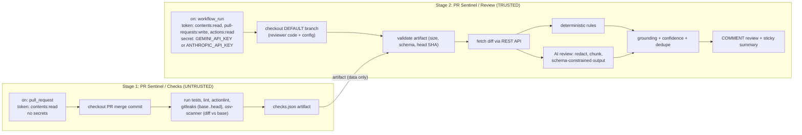

# Architecture and threat model

## Goals and non-goals

PR Sentinel is an **advisory** reviewer. It reports; people decide.

- It posts one `COMMENT` review (line comments) and one summary comment per PR.
- It never approves, requests changes, merges, labels, pushes, or edits code. The GitHub client
  has no methods that could do so ([`github.py`](../src/pr_sentinel/github.py)), and the token
  cannot do so either.
- It is not a merge gate. Branch protection should require the **checks** workflow (tests, lint,
  scanners), which is deterministic and reproducible. AI findings are not suited to gating.

## Two workflows, two trust levels

Why the split: a fork PR's code must never run where secrets or a write token exist, but a
review comment needs a write token and the AI call needs a secret. `pull_request` gives the first
property, `workflow_run` the second. The only thing crossing the boundary is a JSON artifact
treated as hostile input. This is GitHub's recommended pattern for untrusted PRs; the common
alternative, `pull_request_target` with a checkout of the PR head, is the "pwn request" bug class
and is detected by rule `gha-privileged-checkout`.

## Pipeline (review job)

| Step | Module | Notes |
| --- | --- | --- |
| Parse event, abort if not a PR run or checks were skipped/cancelled | `pipeline.py` | Abort = exit 0, nothing posted |
| Load artifact: 2 MB cap, strict schema (`extra="forbid"`) | `pipeline.load_artifact` | Invalid → ignored, noted in summary |
| Fetch PR; require `pr.head.sha == workflow_run.head_sha` and `state == open` | `pipeline.py` | Binds the untrusted PR number to GitHub's own event data |
| Fork policy (`require-label` default) | `pipeline.py` | Controls API spend on outsider PRs |
| List files via API (≤3000), build `FileDiff`s | `diff.py` | GitHub omits patches for binary/huge files → skipped with reason |
| Filter: deleted, binary, lockfiles, vendored, minified, size and count caps | `filters.py` | Every skip is listed in the summary |
| Deterministic rules on **added lines** | `rules.py` | Secrets, injection sinks, TLS off, workflow hardening, injection text |
| AI review | `ai/reviewer.py` | See below |
| Merge findings across sources | `pipeline.merge_findings` | Same file+line+category: deterministic wins |
| Inline selection: severity ≥ threshold, line is commentable, not posted before | `pipeline.select_inline` | Fingerprints read only from comments the bot authored |
| Post `COMMENT` review; on 422 fall back to summary-only; upsert summary | `pipeline.py` | Idempotent across re-runs |

### AI review

1. **Redact** secrets from every line before it leaves the runner (`redact.py`).
2. **Render** each file with explicit new-file line numbers so the model cites real lines.
3. **Chunk** whole files (never split hunks) into ≤`max_chunk_chars` requests, at most
   `max_chunks` per PR. Files over budget are skipped and listed, never truncated.
4. **Call** the provider with a JSON schema (`ai/schema.py`). No tools, no repository access.
5. **Validate** each item independently with Pydantic; one bad item does not discard the rest.
6. **Ground**: path must be a file sent in that chunk; line must be commentable; evidence must
   appear verbatim (whitespace-normalised) within ±3 lines; at least one *added* line must be in
   that window. The line is snapped to where the evidence actually is.
7. **Filter** by confidence (≥0.7 default), dedupe by location, rank, cap at `max_findings`.

Every rejection is counted by reason and shown in the summary, so drift in model quality is
visible rather than silent.

### Provider interface

`ReviewProvider.complete(ModelRequest) -> ModelResponse` (JSON text plus usage). Prompting,
validation and grounding live outside the provider, so a replacement cannot weaken them.
Shipped implementations: `GeminiProvider` (Gemini API via `google-genai`, JSON-schema
structured output, SDK retries), `AnthropicProvider` (Claude via the Messages API with structured
outputs, adaptive thinking, configurable effort, server-side refusal fallback) and
`FakeProvider` (tests, dry runs, the offline demo). Adding another provider is one class plus
one branch in `cli._provider_factory`.

## Threat model

Assets: repository write access, the model API key, maintainers' attention, API budget.
Attacker: anyone who can open a PR, including from a fork, controlling all PR content (code,
file names, PR title/body, commit messages, and the PR's copies of workflow files and config).

| Threat | Mitigation | Residual risk |
| --- | --- | --- |
| PR code exfiltrates secrets or abuses a write token | PR code runs only in `pull_request` (read-only token, no secrets); `persist-credentials: false`; credential-like env vars stripped before running checks | None beyond GitHub's own `pull_request` isolation |
| Privileged job executes PR code | Review job checks out the default branch only; diff comes from the API; scanners are not run there; policy tests fail the build on a `ref:`/head checkout | Maintainers could edit the workflow; tests catch the common forms |
| Tampered checks artifact (forged findings, wrong PR number, huge file) | Size cap, strict schema, PR number trusted only after head-SHA match with `workflow_run` | Forged check *results* can still appear in that PR's own summary (labelled as coming from the PR's workflow). The GitHub check status is the authority. |
| Prompt injection to suppress findings | Deterministic rules run independently; injection-like text is itself flagged; nonce-delimited untrusted block | The model can still be talked out of a real finding. AI review is an addition to the deterministic layer, not a replacement for it. |
| Prompt injection to post misleading or abusive comments | Output is schema-only; findings must quote real diff code at a real line; mentions, HTML, images and links are neutralised; the summary contains no model free text | A grounded but wrong finding can be posted, labelled "AI-generated, verify before acting". |
| Prompt injection to exfiltrate secrets | The model never sees secrets: no keys in the prompt, diff secrets are redacted, no tools or network | None known |
| Forged hidden markers to suppress inline comments or hijack the summary | Markers only trusted in comments authored by `github-actions[bot]`; evidence cannot contain a parseable marker | None known |
| Secret leakage via logs, artifacts or comments | Redaction on check output, evidence and model text; HTTP client debug logs suppressed; Actions masks secrets | Novel secret formats not matched by patterns |
| API cost abuse via fork PRs or huge diffs | Fork AI review requires a maintainer label; chunk and file caps; job timeouts; concurrency cancellation | A labelled PR can still spend up to `max_chunks` requests per push |
| Cache poisoning across trust levels | `setup-uv` cache disabled in the action | — |
| Supply chain (actions, tools, packages) | Actions pinned by SHA; scanner binaries checksum-pinned in-repo; `uv sync --frozen` verifies lockfile hashes; Dependabot for bumps | Trust in pinned upstream versions |
| Config tampering by the PR | Review job reads config from the default branch | Checks job uses the PR's config (by design: it is untrusted anyway) |

## Technology choices

| Choice | Why | Trade-off |
| --- | --- | --- |
| **Python 3.12+** | Pydantic for strict schema validation of both untrusted artifacts and model output; mature test tooling; first-party Anthropic SDK | Slower cold start than a bundled JS action (~10 s for `uv sync`) |
| **uv + lockfile** | Reproducible, hash-verified installs; fast | Users need uv locally (one install command) |
| **Composite action** | One `action.yml` used by both stages; no Docker build on every run | Linux x86_64 only for the scanners |
| **httpx2** for GitHub | Already a dependency of the Anthropic SDK; `MockTransport` makes integration tests realistic without network | — |
| **gitleaks + osv-scanner** | Best-in-class, single static binaries, JSON output | Adds ~15 s download per checks run |
| **Claude Opus 5.5, effort `high`** | Strongest current reviewer; structured outputs guarantee parseable JSON | Cost; `model`/`effort` are config knobs (e.g. `claude-sonnet-5-5` / `medium` for cheaper runs) |
| **Rules as regexes on added lines** | Fast, explainable, zero false negatives from injection | Not semantic; a SAST tool (Semgrep, CodeQL) is the next step for depth |

## Assumptions

- GitHub.com or GHES with `GITHUB_API_URL`; `ubuntu-24.04` runners.
- The repository's default branch is protected (otherwise "trusted base" means little).
- The bot identity is `github-actions[bot]` (default `GITHUB_TOKEN`). A GitHub App token needs
  `--bot-login` set to the app's bot login.
- Python is the first-class language for rules; AI review is language-agnostic.
